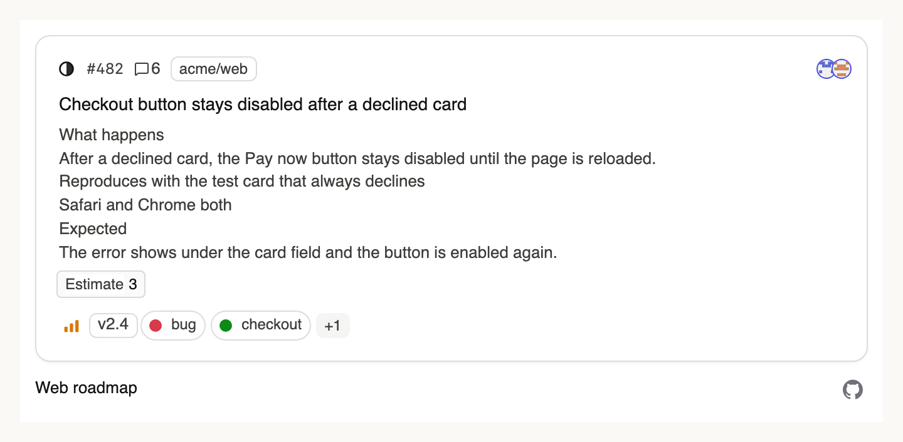
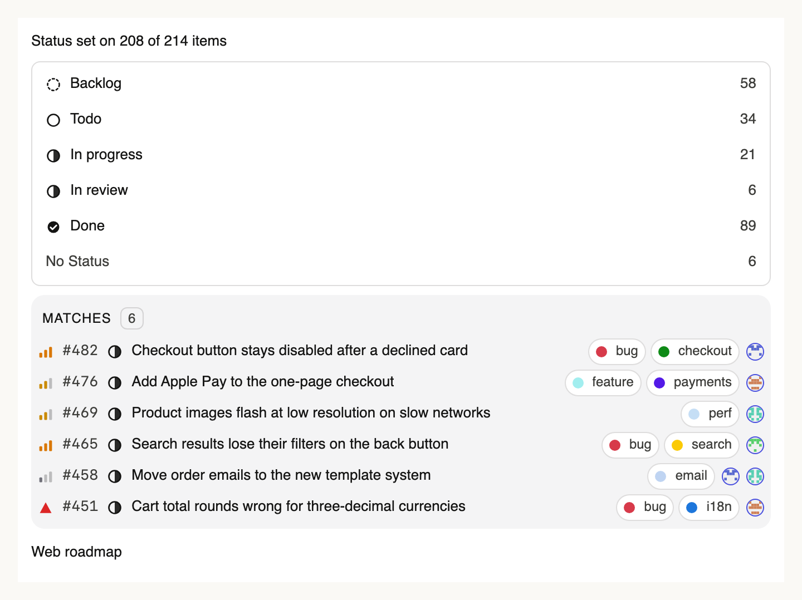
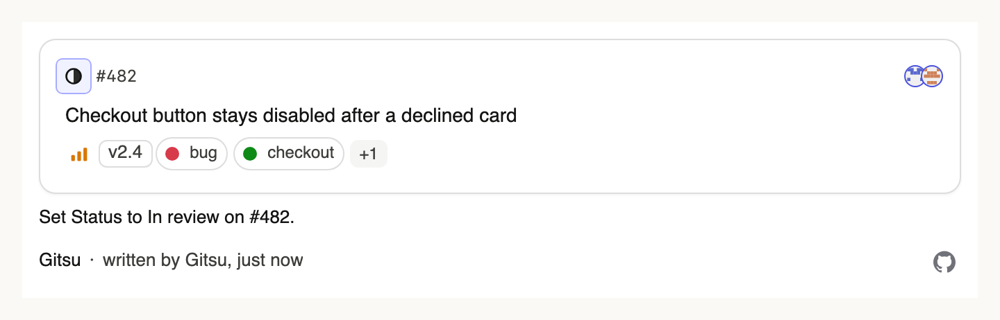

# Gitsu for Claude

Gitsu is an app for GitHub Projects v2 boards. This plugin lets Claude read and
update the items on your boards.

## Requirements

- A GitHub account. You sign in with GitHub the first time Claude uses the
  plugin. Nothing is installed on your computer.
- A Gitsu Pro subscription (https://gitsu.app/pricing). Without it, every tool
  answers that agent access needs Pro.

## Install

```
/plugin marketplace add Coduo-Studio/gitsu-claude
/plugin install gitsu@gitsu
```

Then run `/mcp`, pick `gitsu`, and sign in with GitHub.

## How it connects

The plugin holds no code. It connects Claude to Gitsu's hosted MCP server at
`https://dash.gitsu.app/api/mcp` (Streamable HTTP). When you sign in, Claude
sends you to GitHub to approve Gitsu, then holds a Gitsu access token for 90
days. Revoking the Gitsu app in your GitHub settings ends it at once.

## Tools

Read: `list_projects`, `list_items`, `get_item`, `list_fields`.

Write: `create_item`, `add_comment`, `add_labels`, `remove_labels`,
`close_item`, `reopen_item`, `set_field_value`, `start_work`, `finish_work`.
No tool deletes an item.

## Cards

In Claude on the web, Claude Desktop and Claude mobile, Gitsu draws a card
beside the answer: the item for `get_item`, the matching items for
`list_items`, your boards for `list_projects`, a board's columns for
`list_fields`, and the changed item after each write tool. Cards link to
GitHub. Claude Code in the terminal shows the text answer only, which is the
same text every client gets.







## What leaves your machine

- Claude sends each tool call to `dash.gitsu.app`.
- Gitsu's server calls GitHub (`api.github.com/graphql`) with your own GitHub
  token, at the moment of the call. It keeps no copy of your boards, items or
  comments.
- Gitsu's server checks your Pro subscription by your GitHub user id before
  each call.
- It logs one line per tool call: your GitHub user id, the tool's name, and
  whether it worked. No arguments and no board content. When something fails,
  it sends a scrubbed crash report.
- Comments and issues the plugin writes carry an invisible HTML comment naming
  the assistant that wrote them, so you can tell agent text from your own on
  GitHub.

## The Gitsu app

If you use the Gitsu macOS app (https://gitsu.app), it installs its own Claude
Code plugin from Settings → Claude Code plugin. That plugin adds a band above
Claude Code's prompt showing the items Claude is working on.

## Support

hello@coduo.co

License: MIT. See LICENSE.
